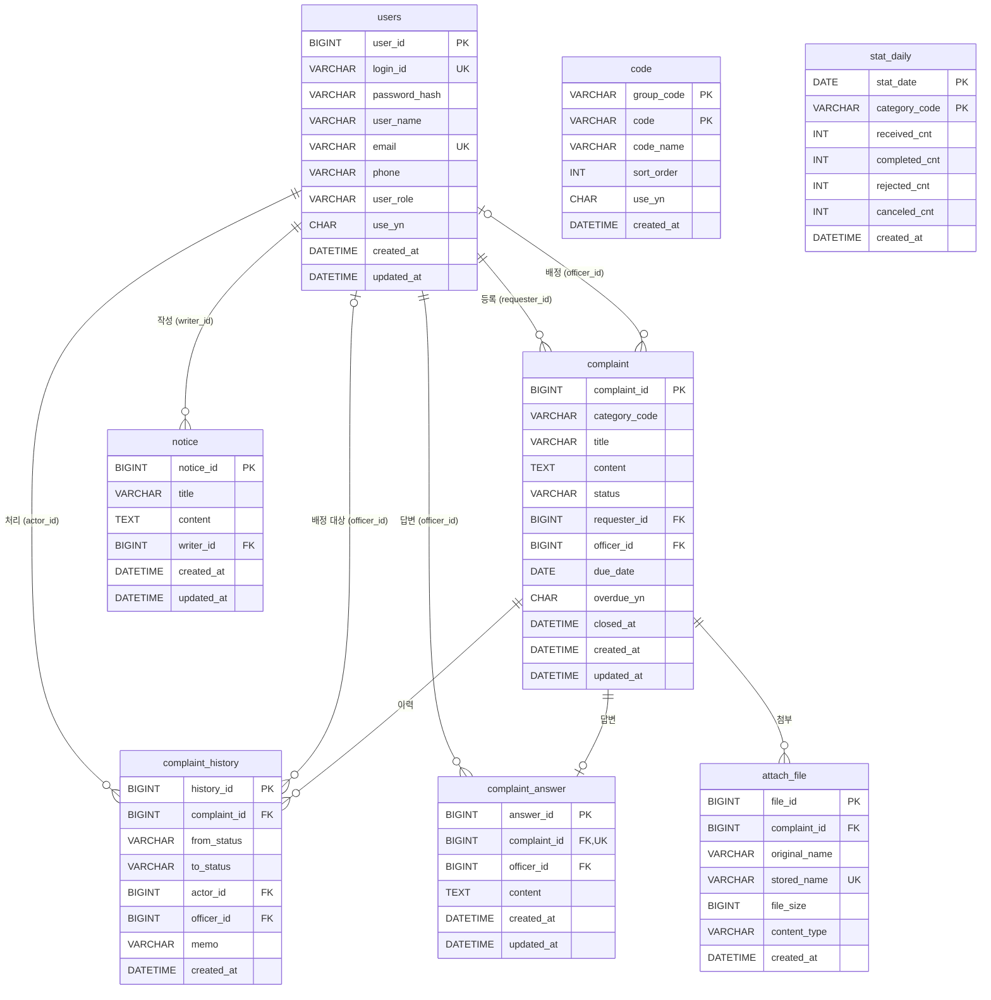

# ERD (Entity Relationship Diagram)

| 항목 | 내용 |
|---|---|
| 프로젝트 | eGov-CivicFlow (민원 접수·처리 시스템) |
| 기준 문서 | [01-requirements-spec.md](01-requirements-spec.md) v0.3 |
| 문서 버전 | v0.1 |
| 작성일 | 2026-11-22 |
| DB | MariaDB (InnoDB, utf8mb4) |
| DDL | `schema.sql` (테이블 생성), `seed.sql` (샘플 데이터) |

## 1. ERD

`code`와 `stat_daily`는 다른 테이블과 외래키로 연결되지 않습니다. (2.3 참고)

## 2. 설계 원칙

### 2.1 공통

- 테이블과 컬럼 이름은 소문자 snake_case로 통일한다. (리눅스의 MariaDB는 테이블 이름의 대소문자를 구분한다.)
- 모든 테이블은 InnoDB, `utf8mb4`를 사용한다.
- PK는 `BIGINT AUTO_INCREMENT`이다. (`code`, `stat_daily`는 복합 PK)
- Y/N 값은 `CHAR(1)`로 저장하고 CHECK로 제한한다.
- 외래키는 모두 `ON DELETE RESTRICT`이다. 민원과 이력은 삭제하지 않는 데이터이며, 사용자도 삭제하지 않고 `use_yn = 'N'`으로 비활성화한다.
- 컬럼 이름 `role` 대신 `user_role`을 쓴다. (예약어와 혼동될 여지를 피하기 위함)

### 2.2 이력과 재배정 (BR-01, BR-09)

- 상태가 바뀌거나 담당자가 바뀔 때마다 `complaint_history`에 한 줄씩 추가한다.
- 최초 등록은 `from_status = NULL`, `to_status = RECEIVED`로 기록한다.
- 배정은 `RECEIVED → ASSIGNED`이며 `officer_id`에 담당자를 기록한다.
- **재배정은 `from_status = to_status = ASSIGNED`이면서 `officer_id`가 새 담당자인 행**으로 기록한다. 민원(`complaint`)의 `status`는 그대로 두고 `officer_id`만 바꾼다.
- 상태 변경과 이력 추가는 한 트랜잭션으로 처리한다.

### 2.3 공통코드와 통계

- `code`는 화면 표시 이름과 정렬 순서를 위한 테이블이다. 상태와 역할은 CHECK 제약으로, 민원 분류(`category_code`)는 애플리케이션에서 검증한다. (공공 프로젝트에서 공통코드는 FK 없이 논리적으로 참조하는 방식이 흔하다.)
- `stat_daily`는 일별 통계 배치(BT-01)가 채우는 집계 테이블이며, 민원 테이블과 FK로 묶지 않는다.

### 2.4 답변과 첨부파일

- 답변은 민원당 1건이다. (`complaint_answer.complaint_id` UNIQUE)
- 첨부파일은 서버 디스크에 UUID 기반 이름으로 저장하고, DB에는 원본 이름과 메타정보만 둔다. (BR-07, BR-08)

## 3. 인덱스

| 테이블 | 인덱스 | 용도 |
|---|---|---|
| users | `login_id` UNIQUE, `email` UNIQUE | 로그인, 중복 방지 |
| complaint | `(requester_id, created_at)` | 민원인의 내 민원 목록 |
| complaint | `(officer_id, status)` | 담당자의 배정 목록 |
| complaint | `(status, created_at)` | 관리자의 상태별 조회 |
| complaint | `(status, due_date)` | 기한 초과 배치 (BT-02) |
| complaint | `(category_code, created_at)` | 분류별 조회, 통계 |
| complaint_history | `(complaint_id, created_at)` | 민원 상세의 처리 이력 |
| complaint_answer | `complaint_id` UNIQUE | 민원당 답변 1건 |
| attach_file | `stored_name` UNIQUE, `complaint_id` | 파일명 중복 방지, 민원별 조회 |
| notice | `created_at` | 공지 목록 정렬 |

## 4. 요구사항과의 연결

| 요구사항 | 관련 테이블 |
|---|---|
| FR-C-01, FR-A-01 | users |
| FR-C-02 ~ 05, FR-A-03 | complaint, attach_file |
| FR-O-01 ~ 04, FR-A-04 | complaint, complaint_history, complaint_answer |
| FR-A-02 | code |
| FR-A-05, BT-01 | stat_daily, complaint |
| FR-C-06, FR-A-06 | notice |
| BR-01, BR-09 | complaint_history |
| BR-06, BT-02 | complaint (`due_date`, `overdue_yn`) |
| BR-07, BR-08 | attach_file |
| SR-01 | users (`password_hash`) |

## 5. 변경 이력

| 버전 | 날짜 | 내용 |
|---|---|---|
| v0.1 | 2026-11-22 | 초안 작성 |
